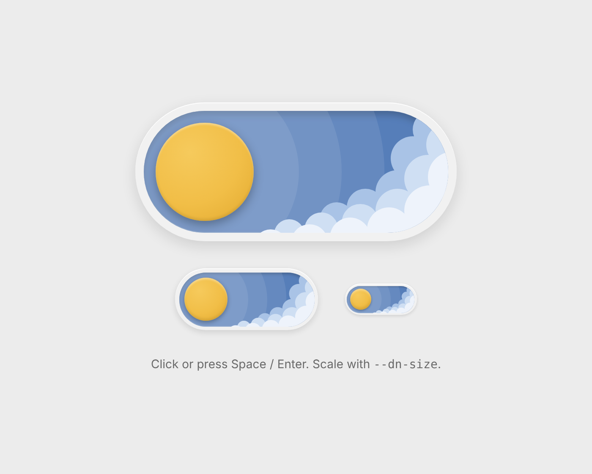
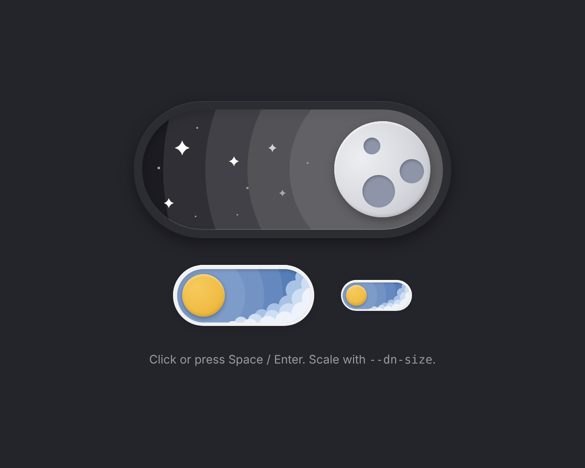

# Day / Night Toggle

Animated theme switch: a sun that slides across and turns into a cratered moon, clouds that sink away, stars that fade in, and light bands that follow the knob.




## Files
- `day-night-toggle.css` – styles (scale with `--dn-size`, the track height; default `144px`)
- `day-night-toggle.js` – injects the markup and handles the switch
- `index.html` – demo page

## Use
```html
<link rel="stylesheet" href="day-night-toggle.css">
<button class="dn-toggle" aria-label="Dark mode"></button>
<script src="day-night-toggle.js"></script>
<script>
  document.querySelector('.dn-toggle').addEventListener('dn-change', e => {
    document.documentElement.classList.toggle('dark', e.detail.night);
  });
</script>
```

- Native `<button role="switch">` with `aria-checked`, so keyboard (Space / Enter) and screen readers work out of the box.
- Start in night mode with `aria-checked="true"`.
- Respects `prefers-reduced-motion`.
- Colours are CSS custom properties (`--dn-sky-day`, `--dn-sun`, `--dn-sky-night`, `--dn-moon`, ...).
